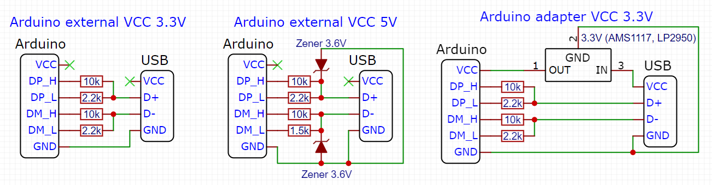

This is an automatic translation and may be incorrect in some places. See the source README and examples for authoritative information.

[](https://github.com/GyverLibs/QuickCharge/releases/latest/download/QuickCharge.zip)
[](https://registry.platformio.org/libraries/gyverlibs/QuickCharge)
[](https://alexgyver.ru/)
[](https://alexgyver.ru/support_alex/)
[](https://github-com.translate.goog/GyverLibs/QuickCharge?_x_tr_sl=ru&_x_tr_tl=en)  

[](https://t.me/GyverLibs)

# QuickCharge
A library for adapter management with QuickCharge 2.0/3 technology. 0
- QC 2.0: fixed voltage 5V, 9V, 12V (Class A/B) and 20V (Class B)
- QC 3.0: Fixed (as in QC 2.0) + adjustable voltage with 200mV increments: 3.6-12V (Class A/B) or 3.6-20V (Class B)
- Definition of the QC version from the program
- Supports “hot” connection
- Power voltage MK: 3.3-3.6V or 5V (see diagrams)
- 4 digital pins are required to work

### Compatibility
Compatible with all Arduino platforms (Arduino features are used)

## Contents
- [Installation](#install)
- [Connection](#wiring)
- [Initialization](#init)
- [Use of use](#usage)
- [Example](#example)
- [Versions](#versions)
- [Bugs and feedback](#feedback)

<a id="install"></a>
## Installation
- The library can be found under the name **QuickCharge** and installed through the library manager in:
    - Arduino IDE
    - Arduino IDE v2
    - PlatformIO
- [Download the library](https://github.com/GyverLibs/QuickCharge/archive/refs/heads/main.zip).zip archive for manual installation:
    - Unpack and put in *C:\Program Files (x86)\Arduino\libraries* (Windows x64)
    - Unpack and put in *C:\Program Files\Arduino\libraries* (Windows x32)
    - Unpack and put in *Documents/Arduino/libraries/ *
    - (Arduino IDE) Automatic installation from .zip: *Sketch/Connect library/Add .ZIP library...* and specify downloaded archive
- Read more detailed instructions for installing libraries[here](https://alexgyver.ru/arduino-first/#%D0%A3%D1%81%D1%82%D0%B0%D0%BD%D0%BE%D0%B2%D0%BA%D0%B0_%D0%B1%D0%B8%D0%B1%D0%BB%D0%B8%D0%BE%D1%82%D0%B5%D0%BA)
### Update
- I recommend always updating the library: new versions fix errors and bugs, as well as optimize and add new features.
- Through the library manager IDE: find the library as when installing and click "Update"
- Manually: **Delete the folder with the old version** and then put the new one in its place. “Replacement” can not be done: sometimes new versions delete files that will remain when replaced and can lead to errors!

<a id="wiring"></a>
## Connection
- The first scheme - MK is powered by an external source 3. 3V
- The MK is powered by an external 5V source (such as a nearby USB port).
- The third scheme - the MK is powered by the same high voltage QC port via a stabilizer.



<a id="init"></a>
## Initialization
```cpp
QuickCharge adapter(uint8_t DP_H, uint8_t DP_L, uint8_t DM_H, uint8_t DM_L);                // pinage
QuickCharge adapter(uint8_t DP_H, uint8_t DP_L, uint8_t DM_H, uint8_t DM_L, bool CLASS);    // class
```

<a id="usage"></a>
## Use of use
```cpp
uint8_t begin();        // Perform an agreement with the adapter, return the adapter version:
  - QC_NA (0): не поддерживает быструю зарядку
  - QC_GEN1 (1): (QC 1.0) поддерживает быструю зарядку большим током - 5V 2A
  - QC_GEN2 (2): (QC 2.0, QC 3.0) поддерживает быструю зарядку высоким напряжением
  
void setClass(class);   // Set the adapter class (by omission QC CLASS A). class:
  - QC_CLASS_A: макс. напряжение  12V
  - QC_CLASS_B: макс. напряжение  20V
  
void setMode(mode);     // Set a fixed voltage or adjustable voltage mode. mode:
  - QC_5V, QC_9V, QC_12V, QC_20V - фиксированное напряжение (QC 2.0/3.0)
  - QC_VAR - настраиваемое напряжение (QC 3.0)
  
void set(int);          // Set the output voltage in millivolts (QC VAR and QC3.0 mode required)
void inc();             // Increase output voltage by 200mV (QC VAR and QC3.0 mode required)
void dec();             // Reduce output voltage by 200mV (QC VAR and QC3.0 mode required)
int voltage();          // Get current adapter voltage
```

In addition:
- You can only exit **QC VAR** by switching to **QC 5V**
- Entering **QC VAR** retains the voltage already set (e.g. when switching from QC 9V)
- From the program it is impossible to distinguish between QC 2.0 and QC 3.0, the version of the adapter is indicated on the housing. Accordingly, the QC VAR mode will simply not work on adapters with QC version less than 3. 0
- Not all adapters can give a voltage below 5V, see the sticker on the case

<a id="example"></a>
## Example
```cpp
#define DP_H_PIN  2
#define DP_L_PIN  3
#define DM_H_PIN  A4
#define DM_L_PIN  A5

/* Подключаем либу и создаем обьект */
#include <QuickCharge.h>
QuickCharge QC(DP_H_PIN, DP_L_PIN, DM_H_PIN, DM_L_PIN, QC_CLASS_B);

void setup() {
  // QC.setClass(QC CLASS A); // If desired, the adapter class can be changed
  
  Serial.begin(9600);                 // Opening the Serial Port
  Serial.print(F("Charger type: "));  // Indicate the type of adapter

  int type = QC.begin();              // Be sure to call start, return the type of adapter
  switch (type) {                     // Identify the type of adapter found
    case QC_NA:   Serial.println(F("QC is not available")); break;
    case QC_GEN1: Serial.println(F("QC1.0 - (5V 2A)")); break;
    case QC_GEN2: Serial.println(F("QC2.0 or QC3.0")); break;
  }
  
  // Fixed voltage
  QC.setMode(QC_9V);              // Get 9B.
  Serial.print("Voltage: ");      // Reduce current voltage
  Serial.println(QC.voltage());
  delay(3000);                    // Wait.

  QC.setMode(QC_12V);             // Get 12. In
  Serial.print("Voltage: ");      // Reduce current voltage
  Serial.println(QC.voltage());
  delay(3000);                    // Wait.
  
  QC.setMode(QC_VAR);             // set the adjustable voltage mode
}

void loop() {
  /* Управляем выходным напряжением при помощи Serial монитора, отправляя напряжение в целых милливольтах! */
  if (Serial.available() > 1) {           // I got a message from Serial.
    int mv = Serial.parseInt();           // Parsim voltage in millivolts
    QC.set(mv);                           // Set the right voltage.
    Serial.print(F("Set voltage to: "));  // Reduce current voltage
    Serial.print(QC.voltage());
    Serial.println(F(" mV"));
    /*
      Также напряжение можно увеличивать / уменьшать вручную:
      QC.inc();  // Increase voltage by 200 mV
      QC.dec();  // Reduce voltage by 200 mV
    */
  }
}
```

<a id="versions"></a>
## Versions
- v1.0

<a id="feedback"></a>
## Bugs and feedback
If you find bugs, create **Issue**, or better write to the mail immediately.[alex@alexgyver.ru](mailto:alex@alexgyver.ru)  
The library is open for revision and your **Pull Requests*!

When reporting bugs or incorrect work of the library, it is necessary to specify:
- Library version
- What is used by the IC
- SDK version (for ESP)
- Arduino IDE version
- Are embedded examples that use features and designs that cause bugs in your code working correctly?
- What code was downloaded, what work was expected from it and how it works in reality
- Ideally, attach the minimum code in which the bug is observed. Not a canvas of a thousand lines, but a minimum code.
